# Backstage Skynet — Architecture Document

> **Project:** `backstage-skynet` · **Branch:** `integration/infra-agent`
> **Root:** `/Users/akashnadimpally/Desktop/Beta/LOCAL/backstage-skynet`

---

## Table of Contents

1. [System Layers Overview](#1-system-layers-overview)
2. [Frontend — Portal Routes](#2-frontend--portal-routes)
3. [Backend — Plugin Map](#3-backend--plugin-map)
4. [External Integrations](#4-external-integrations)
5. [Infra-Agent — Internal Pipeline](#5-infra-agent--internal-pipeline)
6. [Auth Flows](#6-auth-flows)
7. [RBAC Permissions](#7-rbac-permissions)
8. [Storage & Persistence](#8-storage--persistence)
9. [End-to-End Flow — IaC Request Lifecycle](#9-end-to-end-flow--iac-request-lifecycle)
10. [Directory Layout](#10-directory-layout)
11. [Runtime Dependencies](#11-runtime-dependencies)

---

## 1. System Layers Overview

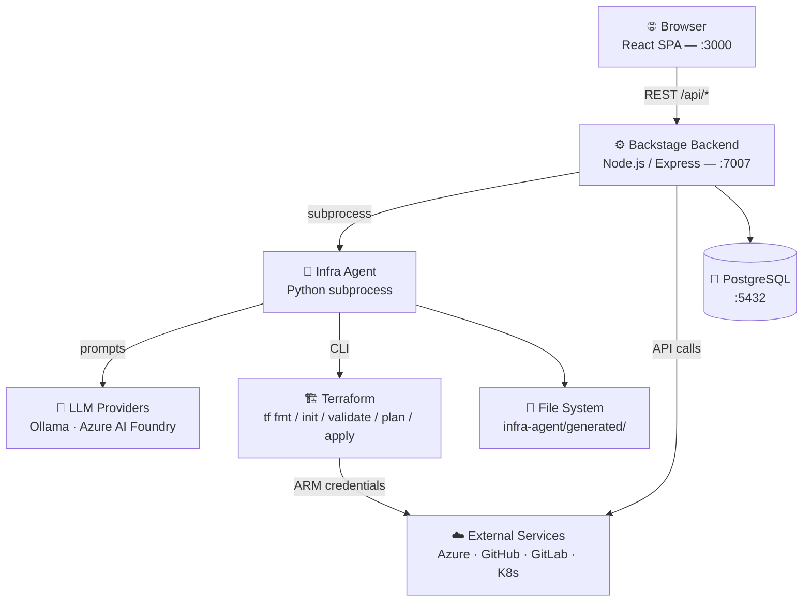

---

## 2. Frontend — Portal Routes

The React SPA is served at `:3000`. Each route maps to a module file inside `packages/app/src/modules/`.

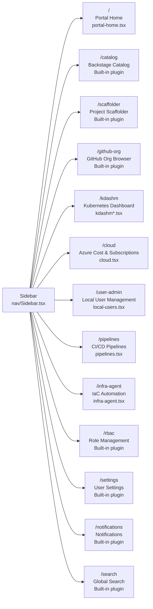

> [!NOTE]
> `portal-home.tsx` acts as the landing dashboard showing 5 plugin cards: **Kubernetes**, **Cloud**, **Pipelines**, **User Admin**, and **Infra Agent**.

---

## 3. Backend — Plugin Map

All plugins are registered in `packages/backend/src/index.ts`. The backend runs on `:7007`.

### 3a. Standard Backstage Plugins

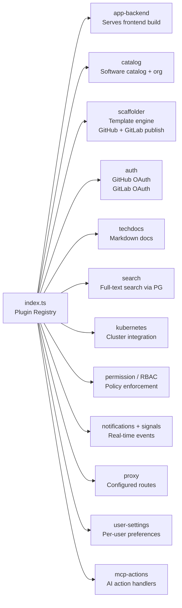

### 3b. Custom Backend Routers

```mermaid
flowchart TD
    IDX["index.ts"]

    IDX --> RC["cloud-auth.ts\n/api/cloud"]
    IDX --> RK["kdashm-router.ts\n/api/kdashm"]
    IDX --> RP["pipelines-router.ts\n/api/pipelines"]
    IDX --> RI["infra-agent-router.ts\n/api/infra-agent"]

    RC --> RC1["GET /api/cloud/login\nAzure device-code MSAL"]
    RC --> RC2["GET /api/cloud/subscriptions\nList Azure subscriptions"]
    RC --> RC3["GET /api/cloud/costs\nAzure cost data"]
    RC --> RC4["GET /api/cloud/resource-groups\nList resource groups"]

    RK --> RK1["GET /api/kdashm/clusters\nAKS cluster list"]
    RK --> RK2["POST /api/kdashm/kubectl\nkubectl exec via kdashm-k8s.ts"]
    RK --> RK3["POST /api/kdashm/helm\nhelm exec"]

    RP --> RP1["GET /api/pipelines\nAzure DevOps + GitHub + GitLab"]
    RP --> RP2["POST /api/pipelines/:id/trigger\nTrigger pipeline run"]

    RI --> RI1["GET /api/infra-agent/status\nAgent health check"]
    RI --> RI2["GET /api/infra-agent/catalog\nList 36 Terraform modules"]
    RI --> RI3["POST /api/infra-agent/requests\nSubmit IaC requirement"]
    RI --> RI4["GET /api/infra-agent/requests\nList all requests + status"]
    RI --> RI5["POST /api/infra-agent/requests/:id/approve\nHMAC approval"]
    RI --> RI6["POST /api/infra-agent/requests/:id/apply\nTrigger apply"]
    RI --> RI7["POST /api/infra-agent/validate\nValidate request YAML"]
```

---

## 4. External Integrations

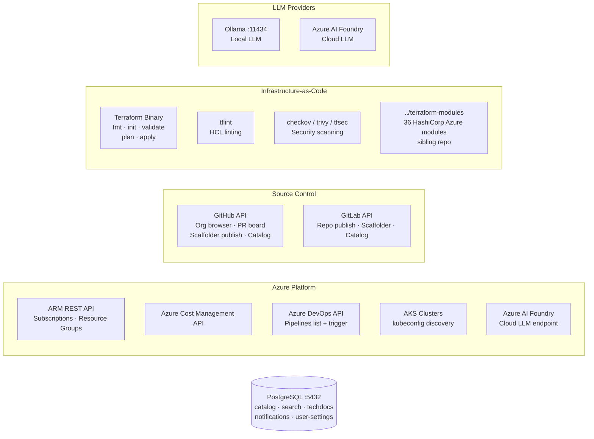

---

## 5. Infra-Agent — Internal Pipeline

The infra-agent is a Python 3.14 service inside `infra-agent/`. It is invoked as a subprocess by `infra-agent-router.ts`.

### 5a. Module Map

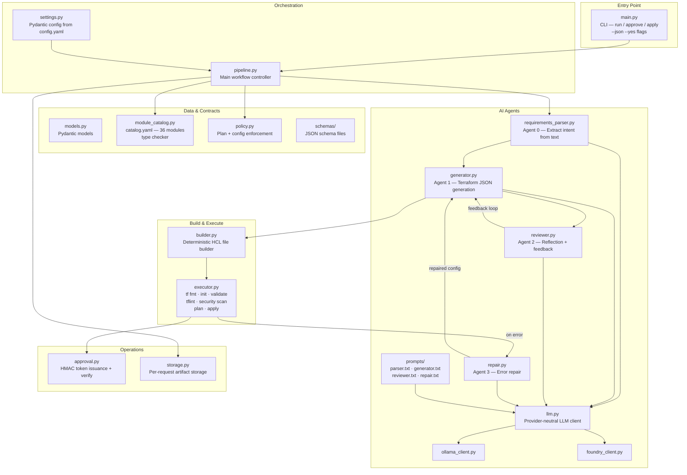

### 5b. Pipeline Stages (Linear View)

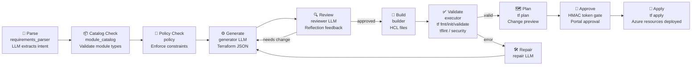

---

## 6. Auth Flows

```mermaid
flowchart TD
    subgraph LOCAL["Local Authentication"]
        LA["User submits\nusername + password"]
        LB["local-auth.ts\nscrypt PBKDF2 hash verify"]
        LC["JWT session issued"]
        LA --> LB --> LC
    end

    subgraph AZURE_AUTH["Azure Authentication"]
        AA["User clicks\nSign in with Azure"]
        AB["cloud-auth.ts\nMSAL device-code flow"]
        AC["Browser shows\ndevice code URL"]
        AD["ARM token stored\nin backend session"]
        AA --> AB --> AC --> AD
    end

    subgraph GH_AUTH["GitHub OAuth"]
        GA["User clicks\nSign in with GitHub"]
        GB["Backstage auth plugin\nOAuth 2.0 redirect"]
        GC["GitHub token\nstored in session"]
        GA --> GB --> GC
    end

    subgraph GL_AUTH["GitLab OAuth"]
        GLA["User clicks\nSign in with GitLab"]
        GLB["Backstage auth plugin\nOAuth 2.0 redirect"]
        GLC["GitLab token\nstored in session"]
        GLA --> GLB --> GLC
    end

    subgraph HMAC_AUTH["Infra Approval Token"]
        HA["infra-agent-router\nreceives approve request"]
        HB["approval.py\nHMAC-SHA256 token generated"]
        HC["Token sent to portal\nuser confirms in UI"]
        HD["approval.py\nverifies HMAC before apply"]
        HA --> HB --> HC --> HD
    end
```

---

## 7. RBAC Permissions

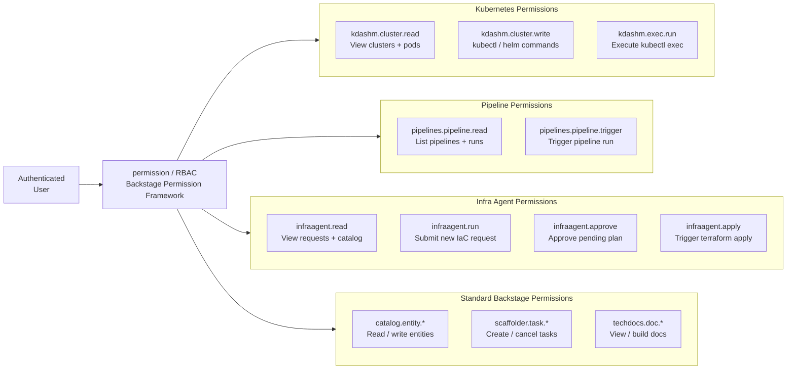

---

## 8. Storage & Persistence

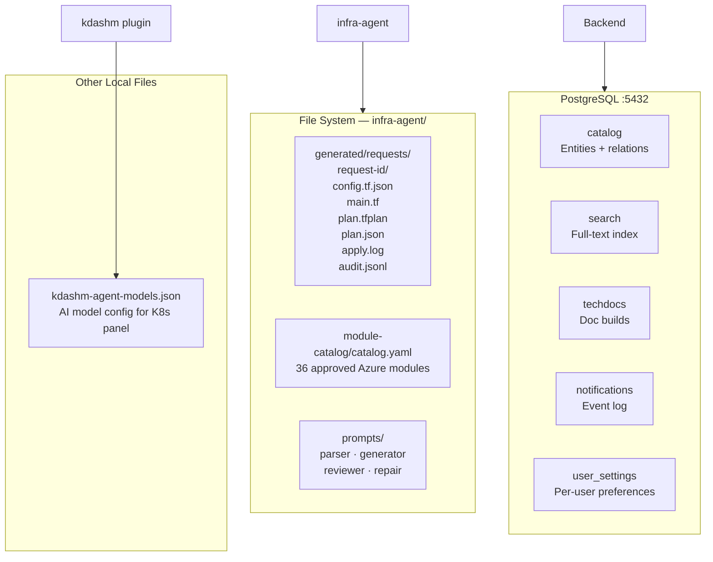

---

## 9. End-to-End Flow — IaC Request Lifecycle

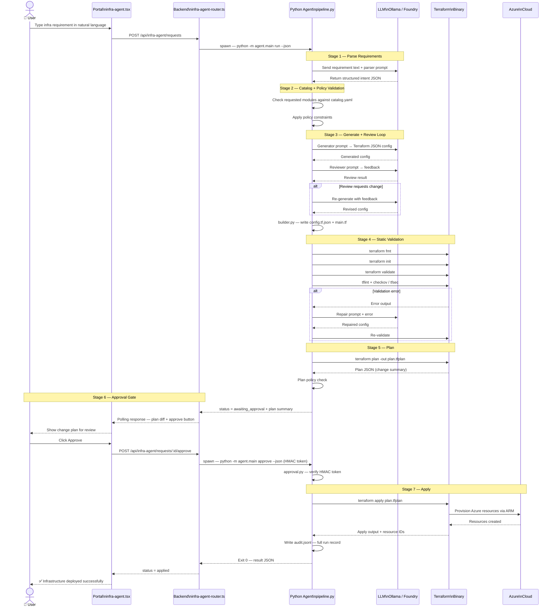

---

## 10. Directory Layout

```
backstage-skynet/
│
├── packages/
│   ├── app/                              # Frontend (React + Backstage UI)
│   │   └── src/
│   │       ├── App.tsx                   # Route registration
│   │       └── modules/
│   │           ├── portal-home.tsx       # / — Landing dashboard
│   │           ├── auth.tsx              # Auth page
│   │           ├── cloud.tsx             # /cloud — Azure cost & subs
│   │           ├── kdashm-home.tsx       # /kdashm — K8s dashboard home
│   │           ├── kdashm-agent-panel.tsx# K8s AI assistant panel
│   │           ├── kdashm-sidebar.tsx    # K8s sidebar nav
│   │           ├── kdashm.tsx            # K8s main view
│   │           ├── local-users.tsx       # /user-admin
│   │           ├── pipelines.tsx         # /pipelines — CI/CD aggregation
│   │           ├── infra-agent.tsx       # /infra-agent — IaC automation
│   │           └── nav/
│   │               ├── Sidebar.tsx       # Global sidebar navigation
│   │               └── SidebarLogo.tsx   # Branding
│   │
│   └── backend/                          # Backend (Node.js + Express)
│       └── src/
│           ├── index.ts                  # Plugin registration entrypoint
│           ├── cloud-auth.ts             # Azure MSAL + cost APIs
│           ├── kdashm-router.ts          # K8s REST routes
│           ├── kdashm-k8s.ts             # kubectl / helm subprocess exec
│           ├── kubernetes-aks-discovery.ts
│           ├── pipelines-router.ts       # Azure DevOps + GitHub + GitLab
│           ├── local-auth.ts             # Scrypt local auth provider
│           └── infra-agent-router.ts     # Infra Agent REST bridge
│
├── infra-agent/                          # Python IaC automation service
│   ├── agent/
│   │   ├── main.py                       # CLI entrypoint (run/approve/apply)
│   │   ├── pipeline.py                   # Workflow orchestrator
│   │   ├── settings.py                   # Pydantic config loader
│   │   ├── models.py                     # Pydantic data contracts
│   │   ├── module_catalog.py             # 36-module catalog + type check
│   │   ├── policy.py                     # Plan + config policy enforcement
│   │   ├── requirements_parser.py        # LLM: intent extraction
│   │   ├── generator.py                  # LLM Agent 1: Terraform JSON
│   │   ├── reviewer.py                   # LLM Agent 2: Reflection
│   │   ├── repair.py                     # LLM Agent 3: Error repair
│   │   ├── builder.py                    # Deterministic HCL builder
│   │   ├── executor.py                   # Terraform CLI execution
│   │   ├── approval.py                   # HMAC token issuance + verify
│   │   ├── storage.py                    # Per-request artifact storage
│   │   ├── llm.py                        # Provider-neutral LLM client
│   │   ├── ollama_client.py              # Ollama provider
│   │   ├── foundry_client.py             # Azure AI Foundry provider
│   │   └── prompts/
│   │       ├── parser.txt
│   │       ├── generator.txt
│   │       ├── reviewer.txt
│   │       └── repair.txt
│   ├── config.yaml                       # Agent configuration
│   ├── module-catalog/catalog.yaml       # 36 approved Azure modules
│   ├── schemas/                          # Pydantic JSON schema files
│   ├── tests/                            # 76 pytest tests (all passing ✅)
│   └── .venv/                            # Python 3.14 virtual environment
│
├── templates/                            # 22 Backstage scaffolder templates
├── examples/                             # Catalog YAML + org.yaml
├── app-config.yaml                       # Development configuration
├── app-config.production.yaml            # Production configuration
├── docker-compose.linux.yml              # Linux Docker Compose
├── docker-compose.windows.yml            # Windows Docker Compose
├── .env.example                          # All required environment variables
└── README.md                             # Project documentation
```

> [!TIP]
> **Sibling repo** `../terraform-modules` (36 HashiCorp Azure modules) lives outside this repo. It is referenced by `infra-agent/config.yaml` via `modules.root: ../../terraform-modules/develop/modules/azure/hashicorp`. It is **not embedded**.

---

## 11. Runtime Dependencies

| Component | Technology | Version | Transport |
|---|---|---|---|
| Frontend SPA | React + Backstage UI | Backstage latest | Browser — `:3000` |
| Backend API | Node.js + Express | Node 20+ | HTTP — `:7007` |
| Infra Agent | Python 3.14 | 3.14 | stdio JSON subprocess |
| Database | PostgreSQL | 14+ | TCP — `:5432` |
| Local LLM | Ollama | Latest | HTTP — `:11434` |
| Cloud LLM | Azure AI Foundry | — | HTTPS |
| IaC Runner | Terraform | ≥ 1.5 | CLI process |
| Linting | tflint | Latest | CLI process |
| Security Scan | checkov / trivy / tfsec | Latest | CLI process |
| Source Control | GitHub REST API v3 | — | HTTPS |
| Source Control | GitLab REST API v4 | — | HTTPS |
| Azure Platform | ARM REST API + MSAL | — | HTTPS |
| Azure CI/CD | Azure DevOps REST API | — | HTTPS |
| Kubernetes | kubectl + kubeconfig | — | kubeconfig clusters |
| Container Runtime | Docker + Docker Compose | — | docker socket |

### Environment Variables Required

| Variable | Used By | Purpose |
|---|---|---|
| `POSTGRES_*` | Backstage backend | Database connection |
| `GITHUB_TOKEN` | Backend auth + scaffolder | GitHub integration |
| `GITLAB_TOKEN` | Backend auth + scaffolder | GitLab integration |
| `AZURE_CLIENT_ID` | cloud-auth.ts | Azure MSAL app ID |
| `ARM_SUBSCRIPTION_ID` | infra-agent | Terraform Azure target |
| `ARM_CLIENT_ID` | infra-agent | Service principal |
| `ARM_CLIENT_SECRET` | infra-agent | Service principal secret |
| `ARM_TENANT_ID` | infra-agent | Azure AD tenant |
| `OLLAMA_BASE_URL` | infra-agent llm.py | Local LLM endpoint |
| `AZURE_FOUNDRY_ENDPOINT` | infra-agent llm.py | Cloud LLM endpoint |
| `AZURE_FOUNDRY_API_KEY` | infra-agent llm.py | Cloud LLM API key |
| `INFRA_AGENT_APPROVAL_SECRET` | approval.py | HMAC signing secret |
| `INFRA_AGENT_DIR` | infra-agent-router.ts | Python service path |
